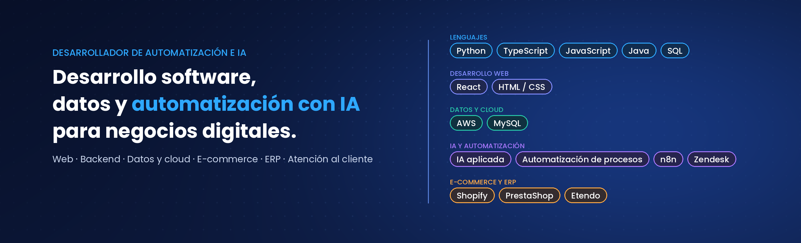

  

<h1 align="center">Pablo García Pampará</h1>

  <b>Desarrollador de Automatización e IA</b> 
  <i>Automatizo procesos completos de empresa (finanzas, apps internas y atención al cliente con IA) | AWS (Lambda, EC2), Python, TypeScript, n8n | Integraciones con ERP y e-commerce | Máster en Automation & AI</i> 
  <i>Cádiz, Andalucía, España</i>

  <a href="https://www.linkedin.com/in/pablo-garcia-pampara">LinkedIn</a> |
  <a href="mailto:pablogarciapampara@gmail.com">Email</a> |
  <a href="https://github.com/pablogarciapampara">GitHub</a>

  
  
  

---

> *"Una automatización que ahorra un paso y deja tres manuales no es una automatización. El objetivo es que el proceso funcione solo y que una persona intervenga solo cuando de verdad hace falta."*

---

<table>
<tr>
<td width="60%" valign="top">

### Sobre mí

- **Automatización de procesos en producción:** en **365Rider**, e-commerce de ciclismo y running con venta en toda Europa, automatizo procesos completos de la empresa que el equipo usa cada día.
- **Finanzas y contabilidad:** automatización de la entrada de facturas y pedidos de compra y su registro en el ERP (**Etendo**), reduciendo tareas manuales y errores.
- **Aplicaciones internas:** herramientas a medida que cualquier persona de la empresa puede usar sin complicaciones.
- **IA aplicada:** soluciones inteligentes para atención al cliente que trabajan con datos reales de cada pedido, con revisión humana en lo delicado.
- **Formación:** Máster en *Automation & AI* en **Nuclio Digital School**, especialización en IA y Big Data y Técnico Superior en DAM.

</td>
<td width="40%" valign="top">

### Ahora mismo

- 🔧 Automatizando procesos financieros y operativos en **365Rider**
- 🤖 Construyendo agentes de IA conectados a sistemas reales
- ☁️ Desplegando en **AWS** con Lambda y EC2
- 📚 Siempre aprendiendo, siempre construyendo
- 💬 Pregúntame por: automatización, IA aplicada, integraciones con APIs

</td>
</tr>
</table>

---

## 🚀 Sistemas en producción y proyectos

### 1. Agente de IA para atención al cliente *(sistema interno en producción, código propietario)*

*Agente que lee los emails de clientes en Zendesk, entiende qué piden y prepara la respuesta con datos reales del pedido.*

- **Clasificación inteligente:** identifica la intención de cada email y en qué punto está el caso, por ejemplo si el cliente ya envió la documentación que se le pidió.
- **Datos en tiempo real:** consulta el estado del pedido en PrestaShop y elige la respuesta adecuada según el estado y el transportista.
- **Multiidioma:** responde en el idioma del cliente usando las plantillas oficiales de la empresa.
- **Control humano:** reglas deterministas para decidir qué se envía, qué se deja como nota interna y qué pasa a una persona.

### 2. Automatización contable y de compras *(sistema interno en producción)*

*Procesos que eliminan trabajo manual en el departamento de finanzas.*

- **Facturas y pedidos de compra:** extracción, validación y registro automático en el ERP.
- **Procesos programados:** importaciones y tareas recurrentes que se ejecutan solas.
- **Datos limpios:** normalización de tarifas y catálogos de proveedores para que los sistemas trabajen sin errores de referencia.

### 3. [Super-MarioJS](https://github.com/pablogarciapampara/Super-MarioJS)

*Juego de plataformas desarrollado desde cero con JavaScript.*

- Recreación del clásico juego de plataformas que se juega directamente en el navegador.

---

## 🛠️ Tecnologías y herramientas

#### Lenguajes y desarrollo web

  

> Python · TypeScript · JavaScript · Java · React · HTML · CSS

#### Cloud, datos y DevOps

  

> AWS (Lambda, EC2) · SQL · MySQL · Git · GitHub · Linux

#### IA, automatización y sistemas de negocio

  
  
  
  
  
  
  

> Automatización de procesos · Agentes de IA · n8n · Integraciones por API · Zendesk · Shopify · PrestaShop · Etendo ERP

---

## 📊 Estadísticas de GitHub

  
  

---

<h3 align="center">Pablo García Pampará</h3>

  <a href="https://www.linkedin.com/in/pablo-garcia-pampara">LinkedIn</a> ·
  <a href="mailto:pablogarciapampara@gmail.com">Email</a> ·
  <a href="https://github.com/pablogarciapampara">GitHub</a>

